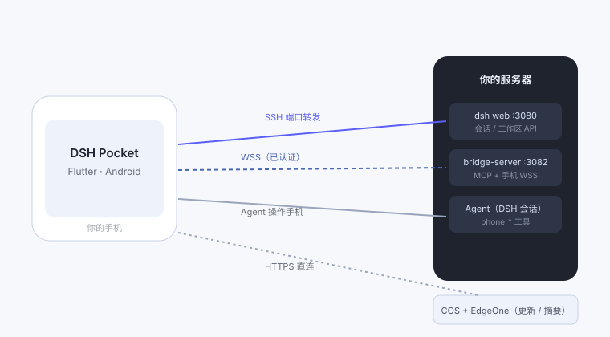

<div align="center">


# DSH Pocket

**An Android client for DeepSeek Harness: connect to your own host over SSH, chat in a native app, and let the agent drive the phone itself.**

[](LICENSE)
[](app/pubspec.yaml)
[](https://developer.android.com)
[](https://flutter.dev)
[](#status)

[中文](README.md) · [English](README.en.md) · [Build guide](docs/build.md) · [Status](docs/pocket-status.md)

</div>



## What it is

DeepSeek Harness ("DSH") runs on your own server and is normally used from a browser.
DSH Pocket replaces "making do with a mobile browser" with a native app: conversations,
sessions and workspace files all live in a native UI. It also opens a reverse channel, so
the agent running inside DSH can operate the phone.

It performs no inference and hosts no data of its own — every request goes to **your** host.

## Features

| | |
|---|---|
| **Remote host** | Enter an SSH target and connect to the `dsh web` already running there (attach-only: it never starts a second instance). Password or key auth, host-key fingerprint pinning (TOFU). |
| **Native chat** | Flutter chat UI with streaming output, Markdown and code blocks, session list and switching. |
| **Workspace files** | Browse and search; preview text, images, PDF, CSV and Excel; save or share artifacts. |
| **Phone bridge** | The app keeps an authenticated WebSocket to `bridge-server`, which gives the agent `phone_*` tools: read/write phone files, clipboard, notifications, launching apps, and accessibility automation (UI tree, taps, swipes, screenshots). |
| **Interest digest** | A server-side job builds a digest from your interests every 6 hours; the app fetches it in the background and notifies only when there is something new. |
| **Pets** | Bundled pet packs (a capybara named Lulu, among others) that react to session state; custom packs can be imported. |
| **Theming** | "Mist glass" visual system, light and dark themes, six launcher icon variants. |
| **Bilingual UI** | Chinese / English, following the system or set manually. |

## Install

Download the APK (self-hosted on Tencent COS behind EdgeOne):

```
https://static.frankfurtlin.top/pocket/apk/dsh-pocket-1.0.2-3-arm64.apk
```

- Android 8.0+ (`minSdk 26`), arm64
- Package: `top.frankfurtlin.dshfusion`
- After installing: **Settings → Remote hosts → Add SSH host**, then paste the **DSH login
  token** — the `?token=` value in the `dsh web` launch URL.

Building from source: see [`docs/build.md`](docs/build.md) (local build, signing, speed-ups
and the pitfalls we hit).

## Server side

The phone bridge is a small Node service:

```bash
cd packages/bridge-server
npm install
DSH_BRIDGE_PUBLIC_ORIGIN=https://dsh.example.com node src/index.js
# MCP endpoint  http://127.0.0.1:3082/mcp
# Phone WSS     http://127.0.0.1:3082/bridge/ws   ← expose this through a reverse proxy
curl -s 127.0.0.1:3082/healthz   # {"ok":true,"service":"dsh-pocket-bridge",...}
```

It binds to loopback only; the public surface is `/bridge/ws`, and `/mcp` asserts the peer is
on loopback. See [`packages/bridge-server/README.md`](packages/bridge-server/README.md).

## Layout

```
app/                     Flutter client (lib/ UI and state, android/ host: bridge service, accessibility)
app/assets/skills/       Skill bundles shipped to the user's DSH host
packages/bridge-server/  Server-side phone bridge (MCP + phone WebSocket)
packages/dsh_client/     Pure Dart client: HTTP/SSE, mux, sessions and workspace APIs
packages/dsh_remote/     Remote transports
runtime/                 Plugins that run inside the host DSH (native plugin protocol)
tools/                   build-apk.sh / verify-bridge.sh / pocket (digest and publishing)
docs/                    Build, architecture, design and ops docs
```

## Docs

| Doc | Contents |
|---|---|
| [`docs/build.md`](docs/build.md) | **How to build**: local build, speed-ups, signing, the R8 post-mortem, pitfalls |
| [`docs/pocket-status.md`](docs/pocket-status.md) | Implementation status and on-device verification log |
| [`docs/architecture.md`](docs/architecture.md) | Architecture and data flow |
| [`docs/pets/README.md`](docs/pets/README.md) | Pet pack format and hard limits |
| [`AGENTS.md`](AGENTS.md) | Conventions for working in this repo |

## Status

In development, primarily for personal use.

- **Verified on a real device**: install and in-place upgrade, SSH remote host, login token,
  11 file-preview formats, pet packs, interest digest, in-app update
- **Not yet verified**: power draw of a long-lived phone bridge, long-term stability of the
  accessibility automation

## License

[AGPL-3.0](LICENSE).

This project is a derivative of [dsh-Go](https://github.com/ccch1mneyyy/dsh-Go) (AGPL-3.0)
and ports the phone-bridge portion of the same author's earlier Capacitor implementation
(MIT). Upstream attribution and third-party asset licenses are in [NOTICE.md](NOTICE.md) and
[THIRD_PARTY_NOTICES.md](THIRD_PARTY_NOTICES.md).

Derivative works must remain AGPL-3.0. Bundled third-party assets (pets, fonts, icons) carry
their own licenses and are not covered by this project's license.
