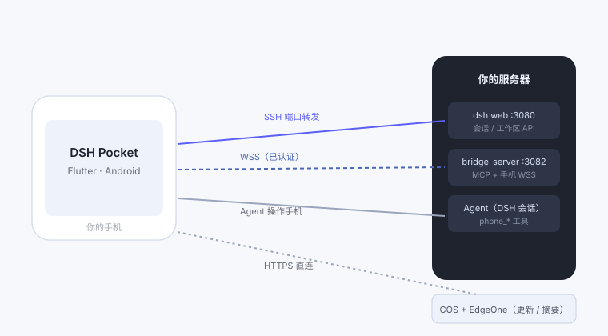

<div align="center">


# DSH Pocket

DeepSeek Harness on your phone: a native Android client that connects to your own host over SSH,
and lets the agent running there operate the device.

[](LICENSE)
[](https://developer.android.com)
[](#status)

**English** · [简体中文](README.zh-CN.md) · [Build guide](docs/build.md)

</div>



## The problem

DeepSeek Harness runs on a server you control and is normally used from a browser. On a phone that
is workable but not pleasant: the sidebar eats the width, the composer fights the keyboard, and
there is no way for the agent to touch the device it is being used from.

DSH Pocket replaces the browser with a native app, and adds a second connection in the opposite
direction, so the agent can read the screen, tap, type and move files on the phone.

It does not run a model and it stores nothing for you. Every request goes to your own host.

## How it works

The app talks to your host over an SSH tunnel forwarded to `dsh web` — the same session you would
have in a browser, rendered in Flutter. A second, authenticated WebSocket connects to a small Node
service on the same host, which exposes `phone_*` tools to the agent over MCP.

Nothing needs to be public except the host you already run.

## Install

Download the APK (self-hosted, served from Tencent COS behind EdgeOne):

```bash
curl -LO https://static.frankfurtlin.top/apps/pocket/apk/dsh-pocket-1.1.3-8-arm64.apk
```

Android 8.0+ (`minSdk 26`), arm64, package name `top.frankfurtlin.dshfusion`.

Then open **Settings → Remote hosts → Add SSH host** and fill in address, port and credentials.
Paste the **DSH login token** — the `?token=` value from the `dsh web` launch URL.

To build it yourself see [docs/build.md](docs/build.md): local toolchain, signing, build timings
and the pitfalls worth knowing.

## The phone bridge

The bridge is a single Node service. It binds to loopback; only `/bridge/ws` has to be reachable
from the phone, and `/mcp` refuses non-loopback peers.

```bash
cd packages/bridge-server
npm install
DSH_BRIDGE_PUBLIC_ORIGIN=https://dsh.example.com node src/index.js

curl -s 127.0.0.1:3082/healthz
# {"ok":true,"service":"dsh-pocket-bridge","phones":0,"version":"0.1.0"}
```

With it running, the agent can list and move files, read the clipboard, post notifications, launch
apps, and drive accessibility (`phone_tree`, `phone_tap`, `phone_swipe`, `phone_screenshot`). See
[packages/bridge-server/README.md](packages/bridge-server/README.md).

## What it doesn't do

- It does not host DSH for you. No account, no cloud, no sync between devices.
- It does not start a DSH instance on your host. Attach-only: if `dsh web` is not running, the app
  cannot create it.
- It does not proxy your traffic. The SSH connection runs straight from the phone to your server.
- iOS and HarmonyOS are not shipped. The platform folders exist but are not maintained.
- Accessibility automation relies on Android's accessibility service and has not been verified for
  long-running use.

## Inside the repo

```
app/                     Flutter client and Android host
packages/bridge-server/  MCP + phone WebSocket server
packages/dsh_client/     Pure Dart client for the DSH API
packages/dsh_remote/     Transports
runtime/                 Plugins that run inside the host DSH
tools/  docs/            Build scripts and documentation
```

`app/lib/` holds the UI and Riverpod state; `app/android/` the bridge service and the accessibility
service. `app/assets/skills/` ships skill bundles that get installed into your host's DSH.

## Status

In development, primarily built for personal use. Verified on a real device: install and in-place
upgrade, SSH remote host, login token, eleven file-preview formats, pet packs, the interest digest
and the in-app updater. Not yet verified: power draw of a long-lived bridge connection, and
long-term stability of the accessibility automation.

## Docs

[docs/build.md](docs/build.md) covers building. [docs/pocket-status.md](docs/pocket-status.md) is
the on-device verification log. [docs/architecture.md](docs/architecture.md) has the data flow,
[docs/pets/README.md](docs/pets/README.md) the pet pack format, and [AGENTS.md](AGENTS.md) the
conventions for working in this repository. The Chinese README,
[README.zh-CN.md](README.zh-CN.md), carries the longer notes.

## Contributing

Issues and pull requests are welcome, though this is a personal project and replies may be slow. Run
`flutter analyze` and the bridge smoke test before opening a PR — see
[CONTRIBUTING.md](CONTRIBUTING.md).

## License

AGPL-3.0. This project is a derivative of [dsh-Go](https://github.com/ccch1mneyyy/dsh-Go)
(AGPL-3.0) and ports the phone bridge from the same author's earlier Capacitor implementation
(MIT). Copyright, upstream attribution and third-party asset licenses live in
[NOTICE.md](NOTICE.md) and [THIRD_PARTY_NOTICES.md](THIRD_PARTY_NOTICES.md).

Bundled assets — pets, fonts, icons — carry their own licenses and are not covered by this one.
