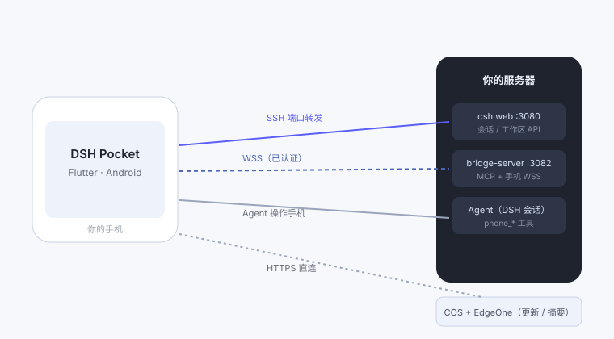

<div align="center">


# DSH Pocket

**把 DeepSeek Harness 装进口袋的 Android 客户端：SSH 连上你自己的主机，在手机原生界面里聊，顺便把手机变成 Agent 的一双手。**

An Android client for DeepSeek Harness. Connect to your own host over SSH, chat in a native app, and let the agent drive the phone itself.

[](LICENSE)
[](app/pubspec.yaml)
[](https://developer.android.com)
[](https://flutter.dev)
[](#状态)

[English](README.md) · **简体中文** · [构建说明](docs/build.md) · [实现状态](docs/pocket-status.md)

</div>



## 这是什么

DeepSeek Harness（下称 DSH）跑在你自己的服务器上，平时通过浏览器访问。DSH Pocket 把
「在手机浏览器里凑合」换成原生 App：对话、会话、工作区文件都在原生界面里操作；同时多出
一条反向通道——DSH 里的 Agent 能操作这台手机。

它不做模型推理，也不托管任何数据：所有请求都发往**你自己的**主机。

## 功能

- **网页登录**：填网址 + dsh-passwords 网关的账号密码就能连，和浏览器同一个入口（最省事）。
- **远程主机**：填 SSH 地址即可连上服务器上的 `dsh web`（只连接模式，不在服务器上另起实例）。
  密码或私钥登录，主机密钥指纹校验（TOFU）。
- **原生对话**：Flutter 原生界面、流式输出、Markdown 与代码块渲染、会话列表与切换。
- **工作区文件**：浏览、搜索、预览文本 / 图片 / PDF / 表格 / Excel，产物可直接保存或分享。
- **手机桥**：App 常驻一条已认证 WSS 到 `bridge-server`，Agent 由此获得 `phone_*` 工具——
  读写手机文件、剪贴板、通知、启动应用，以及无障碍自动化（读屏、控件树、点击、滑动、截屏）。
- **推送历史**：「发现」页按批次回看最近 30 天的推送。
- **兴趣推送**：服务端按兴趣方向每 6 小时生成摘要，App 后台拉取，有新内容才发通知。
- **宠物**：内置宠物包（水豚噜噜等），随会话状态联动，可导入自己的宠物包。
- **主题与图标**：「雾蓝玻璃」视觉体系、明暗双主题、6 套启动图标可选。
- **双语界面**：中文 / English，跟随系统或手动切换。

## 安装

直接装 APK（自建分发，腾讯云 COS + EdgeOne）：

```
https://static.frankfurtlin.top/apps/pocket/apk/dsh-pocket-1.1.3-8-arm64.apk
```

- 平台：Android 8.0+（`minSdk 26`），arm64
- 包名：`top.frankfurtlin.dshfusion`
- 最省事：装完后到「设置 → 远程主机 → 网页登录 → 添加」，填网址、账号、密码；
- 或者「设置 → 远程主机 → 添加 SSH 主机」填地址、端口、用户名与凭据；
  **DSH 登录令牌**填 `dsh web` 启动链接里的 `?token=` 值

从源码构建见 [`docs/build.md`](docs/build.md)（本机构建、签名、提速与坑清单）。

## 服务器侧

手机桥要跑 `packages/bridge-server`：

```bash
cd packages/bridge-server
npm install
DSH_BRIDGE_PUBLIC_ORIGIN=https://dsh.example.com node src/index.js
# MCP 端点   http://127.0.0.1:3082/mcp
# 手机 WSS    http://127.0.0.1:3082/bridge/ws  ← 经反向代理对外
curl -s 127.0.0.1:3082/healthz   # {"ok":true,"service":"dsh-pocket-bridge",...}
```

它只监听回环，公网只暴露 `/bridge/ws`，`/mcp` 有回环断言。细节见
[`packages/bridge-server/README.md`](packages/bridge-server/README.md)。

## 项目结构

```
app/                     Flutter 客户端（lib/ 界面与状态，android/ 宿主：桥服务与无障碍）
app/assets/skills/       随包分发的技能包，安装到用户主机的 DSH
packages/bridge-server/  服务器端手机桥（MCP + 手机 WebSocket）
packages/dsh_client/     纯 Dart 客户端：HTTP/SSE、mux、会话与工作区 API
packages/dsh_remote/     远程传输
runtime/                 跑在宿主 DSH 里的插件（原生插件协议）
tools/                   build-apk.sh / verify-bridge.sh / pocket（摘要与发布）
docs/                    构建、架构、设计与运维文档
```

## 文档

| 文档 | 内容 |
|---|---|
| [`docs/build.md`](docs/build.md) | **怎么编译**：CNB 远程构建、本机签名、提速、签名、R8 复盘、坑清单 |
| [`docs/pocket-status.md`](docs/pocket-status.md) | 当前实现状态与真机验证记录 |
| [`docs/architecture.md`](docs/architecture.md) | 架构与数据流 |
| [`docs/pets/README.md`](docs/pets/README.md) | 宠物包格式与硬限制 |
| [`AGENTS.md`](AGENTS.md) | 在本仓库里工作的约定 |

## 状态

开发中，自用为主。

- **已真机验证**：安装与覆盖升级、SSH 远程主机、登录令牌、11 种文件预览、宠物包、
  兴趣推送、自动更新
- **尚未验证**：手机桥长连的功耗、无障碍自动化的长期稳定性

## 许可

[AGPL-3.0](LICENSE)。

本项目是 [dsh-Go](https://github.com/ccch1mneyyy/dsh-Go)（AGPL-3.0）的衍生作品，并移植了
同一作者早期 Capacitor 实现（MIT）的手机桥部分；上游署名与第三方素材授权见
[NOTICE.md](NOTICE.md) 与 [THIRD_PARTY_NOTICES.md](THIRD_PARTY_NOTICES.md)。

派生作品必须延续 AGPL-3.0。随包分发的第三方素材（宠物、字体、图标）各有其授权，
不在本项目授权范围内。
